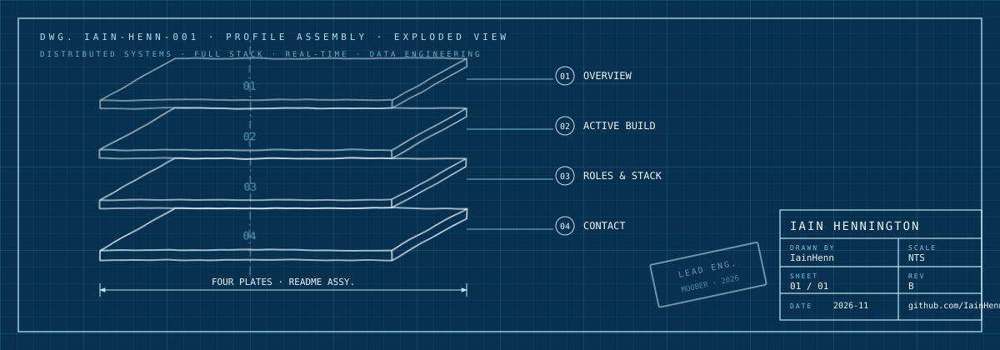

  

### 01 — hero

Hey, I'm **Iain**. Thanks for stopping by!

I'm interested in **distributed systems, full-stack development, microservices, real-time processing, and data engineering**.

### 02 — currently

I'm developing for **[Moober](https://mooberdavis.com/)**, where I serve as **Lead Engineer** for the team.

Side projects on the web:
- **[T Shirt Collection](https://iains-tshirt-collection.com/)**
- **[Co-Todo](https://co-todo.com.de/)** — a collective todo list

### 03 — work

#### What I work with

**Languages:** Python · Golang · TypeScript · Java

**Backend:** Gin · Flask · FastAPI · Spring Boot · NestJS

**Also tinkering:** React · Kafka · Airflow · Spark · GCP · AWS · Cloudflare

#### Where I've been

- **[Fabletics](https://www.fabletics.com/)** — Software Engineering Intern · Summer 2026
- **[Persist AI](https://www.persist.ai/)** — Software Engineering Intern · YC · Series A · 2024–2026

#### What's next

- **[Layup Parts](https://www.layupparts.com/)** — Software Engineering Intern · Winter 2027
- **[Picogrid](https://picogrid.com/)** — Backend Engineer Intern · Summer 2027

### 04 — contact

[Iainevans2005@gmail.com](mailto:Iainevans2005@gmail.com) · [LinkedIn](https://www.linkedin.com/in/iain-hennington-94143b303)